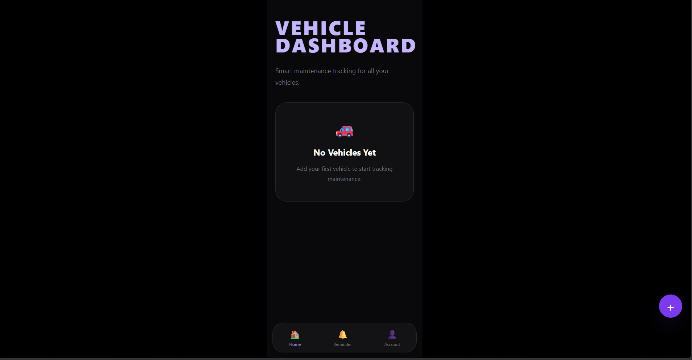

# Vehicle Tracker

Vehicle maintenance tracking app built with Laravel. Track service schedules, tax reminders, odometer updates, and maintenance history.



## Features

- Vehicle management: add, edit, delete, and view vehicles with brand, type, plate number, and odometer.
- Service reminder based on the next service date or distance.
- Tax reminder based on the tax due date.
- Service history per vehicle with odometer and cost.
- Reminder center that collects everything falling due.
- Authentication and profile management.

## Tech stack

| Layer | Choice |
|---|---|
| Framework | Laravel 13 |
| Language | PHP 8.3 |
| Frontend | Blade, Tailwind CSS, Alpine.js |
| Auth scaffolding | Laravel Breeze |
| Database | MySQL |
| Tests | PHPUnit |

## Requirements

- PHP 8.3 or newer with the usual Laravel extensions
- Composer
- Node.js and npm
- MySQL

## Installation

```bash
git clone https://github.com/Amiya23/vehicle-tracker.git
cd vehicle-tracker
composer install
npm install
cp .env.example .env
php artisan key:generate
```

Set the database credentials in `.env`, then:

```bash
php artisan migrate
npm run build
php artisan serve
```

The app redirects the root URL to `/dashboard`, and the dashboard requires login, so start by registering a user.

## Tests

```bash
php artisan test
```

## Project layout

```text
app/Http/Controllers   DashboardController, ReminderController, ProfileController, auth controllers
app/Models             Vehicle, ServiceHistory, User
database/migrations    users, cache, jobs, vehicles, service dates, tax due date, service history
routes/web.php         application routes, all behind the auth middleware
resources/views        Blade views
```

## Status

MVP v1.0 complete.
